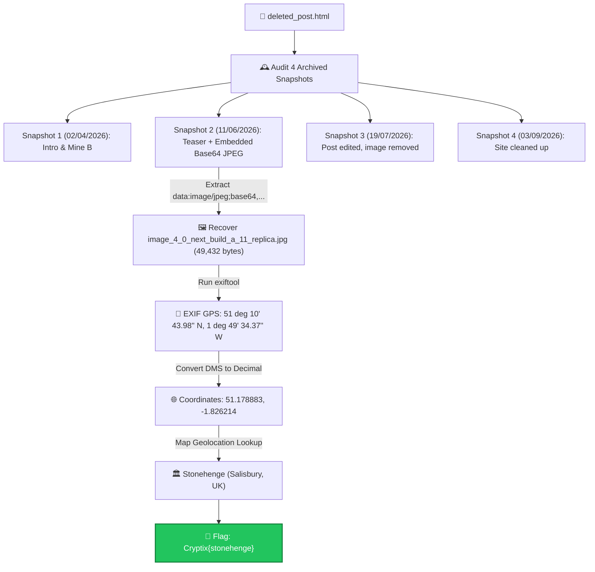

# Old Friends — Cytech CTF Write-Up

> [!NOTE]
> Part of the [**Cyrptix CTF OSINT Write-Ups Collection**](https://github.com/Dabuynyx/Cyrptix-CTF-OSINT-write-up).

<div align="center">


</div>

---

## 📋 Challenge Information

| Field | Detail |
| :--- | :--- |
| **Challenge Name** | Old Friends |
| **Category** | OSINT / Digital Forensics / Web Archive Analysis |
| **Target Identity** | `Cr4t3K1ng` (`cr4t3k1ng.site`) |
| **Artifacts Provided** | `deleted_post.html`, `image_4_0_next_build_a_11_replica.jpg` |
| **Final Flag** | `Cryptix{stonehenge}` |

---

## 🎯 Challenge Narrative & Objective

The challenge provides an HTML file representing historical web snapshots: `deleted_post.html`. The author, a Minecraft builder named **Cr4t3K1ng**, posted a reference photo from a real-world vacation trip, teasing an upcoming 1:1 in-game monument build. 

Although the user later deleted the photograph and edited the post claiming *"took the pic down, gave away too much lol"*, the deleted media was permanently archived in an earlier snapshot of the site.

> **Objective:** Uncover the deleted photo from the web archive timeline, extract the Base64 image payload, perform digital image forensics (EXIF extraction), compute the precise GPS coordinates, and identify the real-world landmark.

**Flag Format:**
```text
Cryptix{<landmark_name>}
```

---

## 🗺️ Investigation Flowchart



---

## 🔍 Step-by-Step Investigation & Forensics Walkthrough

### 1. Auditing the Web Archive (`deleted_post.html`)

Opening `deleted_post.html` revealed a simulated Wayback Machine style interface containing 4 distinct chronological captures of `cr4t3k1ng.site`:

| Snapshot # | Date Stamp | Title / Action | Post Excerpt & Findings |
| :---: | :---: | :--- | :--- |
| **1** | `02/04/2026` | Intro / Mine B | Initial site launch: *"hey, i'm Cr4t3K1ng"* and updates on Minecraft projects. |
| **2** | `11/06/2026` | *"next build: a 1:1 replica"* | **Critical Snapshot.** Author states: *"next project is a 1:1 replica of a real place i visited. here’s my reference pic from the trip. guess where 👀"* Embedded with an inline Base64 JPEG. |
| **3** | `19/07/2026` | Image Deletion | Author removed the photo: *(edit: took the pic down, gave away too much lol) [image removed by author]* |
| **4** | `03/09/2026` | Site Overhaul | Post retitled *"builds coming soon"*: *"cleaning up the site. the replica is still happening, it's a surprise now."* |

---

### 2. Extracting & Decoding the Deleted Image

Navigating into the DOM tree of Snapshot 2 (`11/06/2026`) revealed an inline Base64 data URI inside an `` tag:
```html

```

#### Terminal Extraction Commands:

```bash
# Method A: Using Python standard library (Matches "Photo from the trip" alt tag)
python3 -c '
from html.parser import HTMLParser
import base64

class ImgParser(HTMLParser):
    def handle_starttag(self, tag, attrs):
        if tag == "img":
            d = dict(attrs)
            if "Photo from the trip" in d.get("alt", ""):
                b64 = d.get("src", "").split("base64,")[-1]
                with open("image_4_0_next_build_a_11_replica.jpg", "wb") as out:
                    out.write(base64.b64decode(b64.strip()))
                print("Successfully extracted image_4_0_next_build_a_11_replica.jpg (49,432 bytes)")

ImgParser().feed(open("deleted_post.html", "r", encoding="utf-8", errors="ignore").read())
'
```

#### File Verification:
```bash
file image_4_0_next_build_a_11_replica.jpg
# Output: image_4_0_next_build_a_11_replica.jpg: JPEG image data, JFIF standard 1.01

ls -la image_4_0_next_build_a_11_replica.jpg
# Size: 49,432 bytes
```

---

### 3. EXIF Metadata Extraction

Running `exiftool` on the extracted image revealed intact camera and geolocation metadata:

```bash
exiftool image_4_0_next_build_a_11_replica.jpg
```

#### Detailed Forensic Output:

| EXIF Property | Extracted Value | Analysis |
| :--- | :--- | :--- |
| **Camera Make / Model** | `Pixelfone PF-2 Pro` | Mobile smartphone camera |
| **Date / Time Original** | `2026:06:09 14:22:05` | Taken 2 days before the 11/06/2026 post |
| **Exposure / Aperture** | `1/1200 sec at f/1.8, ISO 50` | Daylight outdoor photograph |
| **GPS Latitude** | `51 deg 10' 43.98" N` | Northern hemisphere coordinate |
| **GPS Longitude** | `1 deg 49' 34.37" W` | Western hemisphere coordinate |
| **GPS Position** | `51 deg 10' 43.98" N, 1 deg 49' 34.37" W` | Complete location pinpoint |

---

### 4. Coordinate Conversion Mathematics

To locate the place on standard mapping services, convert Degrees, Minutes, Seconds (DMS) to Decimal Degrees:

$$\text{Decimal Degrees} = \text{Degrees} + \frac{\text{Minutes}}{60} + \frac{\text{Seconds}}{3600}$$

#### Latitude Calculation:
$$\text{Lat} = 51 + \frac{10}{60} + \frac{43.98}{3600} = 51 + 0.166667 + 0.012217 = 51.178883^\circ\text{ N}$$

#### Longitude Calculation (West is negative):
$$\text{Lon} = -\left(1 + \frac{49}{60} + \frac{34.37}{3600}\right) = -\left(1 + 0.816667 + 0.009547\right) = -1.826214^\circ\text{ W}$$

#### Verification Script:
```bash
python3 -c '
lat = 51 + (10 / 60) + (43.98 / 3600)
lon = -(1 + (49 / 60) + (34.37 / 3600))
print(f"Decimal Coordinates: {lat:.6f}, {lon:.6f}")
'
# Output: Decimal Coordinates: 51.178883, -1.826214
```

---

### 5. Geolocation & Landmark Identification

Putting `51.178883, -1.826214` into mapping platforms:
* **Map Pin:** [https://www.google.com/maps?q=51.178883,-1.826214](https://www.google.com/maps?q=51.178883,-1.826214)
* **Administrative Location:** Salisbury, Wiltshire SP4 7DE, United Kingdom.
* **Identified Monument:** **Stonehenge** — the famous prehistoric megalithic stone circle monument.

---

## 🚩 Final Flag

Formatting the flag as specified (`Cryptix{place_name}`):

```text
Cryptix{stonehenge}
```

---

## 💡 Summary & Key Takeaways

```text
Cr4t3K1ng (cr4t3k1ng.site)
└── deleted_post.html (Historical web archive)
    └── Snapshot 2 (11/06/2026: "next build: a 1:1 replica")
        └── Base64 JPEG data URI
            └── Extracted JPEG file (49,432 bytes)
                └── exiftool forensic inspection
                    ├── Pixelfone PF-2 Pro
                    └── GPS: 51° 10' 43.98'' N, 1° 49' 34.37'' W
                        └── DMS to Decimal: 51.178883, -1.826214
                            └── Stonehenge (Salisbury, Wiltshire, UK)
                                └── Cryptix{stonehenge}
```

> [!IMPORTANT]
> **Key Forensic Lesson:** Deleting content or images from the live version of a website does not remove previous snapshots captured by web archives, search engine caches, or third-party scraper scrapings. Furthermore, mobile devices automatically tag media files with exact GPS EXIF metadata unless specifically stripped by the application or privacy settings prior to upload.
